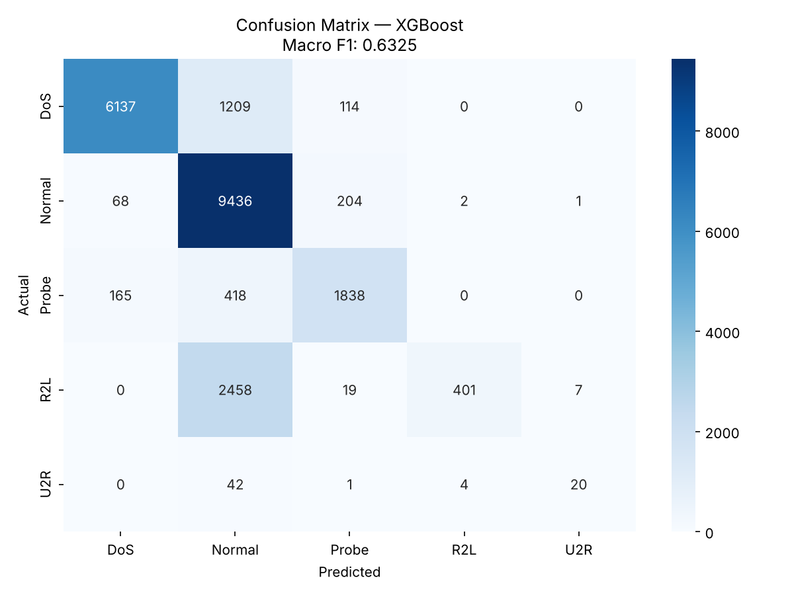

# Network Intrusion Detection (NSL-KDD)

Tunar Abaszada & Javid Malikzade

A machine learning model that classifies network connections from the NSL-KDD
dataset into five categories: Normal, DoS, Probe, R2L and U2R. The best model,
XGBoost trained on SMOTE-balanced data, reaches a **test macro F1 of 0.633**
against a baseline of about 0.47.

## Quick start

```bash
pip install -r requirements.txt
python nids_solution.py
```

The script downloads NSL-KDD (KDDTrain+ and KDDTest+) automatically, trains and
compares four models, prints the results below, and saves
`confusion_matrix.png`. It was developed in Jupyter and also runs as a plain
script. A full run takes about an hour on a 2-core machine, most of it
cross-validation.

## The problem

The dataset is heavily imbalanced. U2R has only 52 training examples while
Normal has over 67,000. The baseline Random Forest reaches a macro F1 of around
0.47, mostly because it almost never detects R2L and U2R attacks. Macro F1 is
used because it weights every class equally, so missing rare attacks is
penalised as much as missing common ones.

## Approach

### Handling class imbalance with SMOTE

SMOTE (Synthetic Minority Over-sampling Technique) creates synthetic examples by
interpolating between existing minority-class records. The training set is
balanced to 67,343 examples per class:

| Class | Before SMOTE | After SMOTE |
| --- | --- | --- |
| Normal | 67,343 | 67,343 |
| DoS | 45,927 | 67,343 |
| Probe | 11,656 | 67,343 |
| R2L | 995 | 67,343 |
| U2R | 52 | 67,343 |

SMOTE is applied to training data only. The test set is never resampled.

### Model comparison

Four classifiers were trained on the same SMOTE-balanced data. Cross-validation
is 5-fold stratified, with **SMOTE applied inside each fold** (see the note
below). The test score is on the untouched KDDTest+ set.

| Model | CV macro F1 | Test macro F1 | Gap |
| --- | --- | --- | --- |
| **XGBoost** | **0.948 ± 0.022** | **0.633** | 0.315 |
| LightGBM | 0.943 ± 0.022 | 0.613 | 0.330 |
| CatBoost | 0.907 ± 0.022 | 0.585 | 0.322 |
| Random Forest | 0.930 ± 0.026 | 0.519 | 0.411 |

XGBoost builds trees sequentially, with each new tree correcting the mistakes of
the previous ones. That helps it learn from rare classes that other models tend
to ignore.

### A note on cross-validation and SMOTE

An earlier version of this project ran cross-validation on data that had
already been oversampled, which gave CV scores of about 0.9998. That number was
inflated by leakage: SMOTE builds synthetic records from their real neighbours,
so near-copies of the same record ended up in both the training and the
validation folds. The fix is an `imblearn` Pipeline that re-runs SMOTE on each
fold's training part only, so validation folds contain only real, unseen
records. The CV scores above come from that corrected setup.

## Results (XGBoost)

| Class | Precision | Recall | F1-score | Support |
| --- | --- | --- | --- | --- |
| DoS | 0.96 | 0.82 | 0.89 | 7,460 |
| Normal | 0.70 | 0.97 | 0.81 | 9,711 |
| Probe | 0.84 | 0.76 | 0.80 | 2,421 |
| R2L | 0.99 | 0.14 | 0.24 | 2,885 |
| U2R | 0.71 | 0.30 | 0.42 | 67 |
| **Macro average** | **0.84** | **0.60** | **0.63** | **22,544** |

| Metric | Score |
| --- | --- |
| Test macro F1 | **0.633** |
| Baseline macro F1 | 0.47 |
| Improvement | +0.16 (about +35% relative) |



Rows are actual classes, columns are predicted classes, and the diagonal shows
correct predictions. DoS and Normal are detected well. R2L is the hardest
class: most R2L attacks are classified as Normal, partly because many R2L
subtypes in the test set never appear in training. U2R recall rose from near
zero in the baseline to 0.30.

### Why the test score is much lower than the CV score

Even with leakage removed, CV (0.948) is far above the test score (0.633). That
gap is expected for this dataset. KDDTest+ deliberately includes attack
subtypes that are not in KDDTrain+, so the test set measures how well the model
handles genuinely new attacks, which is the harder and more realistic question.
The test score is the honest number.

## What we would try next

- **Feature engineering.** Ratios such as source-to-destination bytes, or login
  failures combined with connection flags, may help separate R2L from Normal.
- **Threshold tuning.** Lowering the decision threshold for R2L and U2R would
  flag more rare attacks at some cost to precision. In a SOC, a missed intrusion
  usually costs more than an extra alert to triage.
- **Voting ensemble.** Combining XGBoost and LightGBM may catch cases either
  model misses alone.
- **A neural network.** An MLP might learn subtler differences between Normal
  and R2L traffic, at the cost of more tuning.

## Reproducibility

`requirements.txt` pins the library versions used for these results (Python
3.13). Other versions run fine but can shift scores slightly; for example, an
earlier run with older libraries gave XGBoost a test macro F1 of 0.627.
